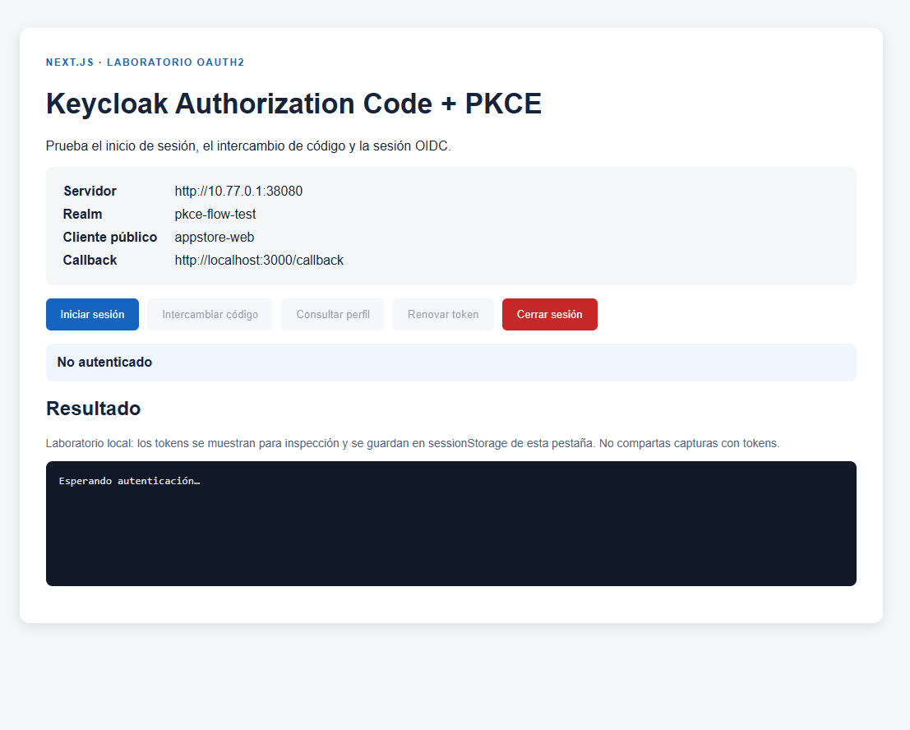
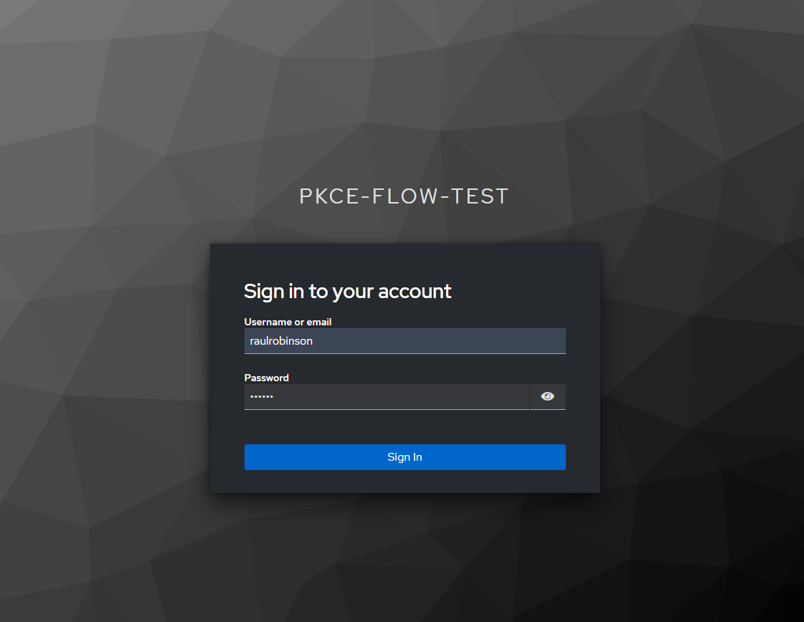
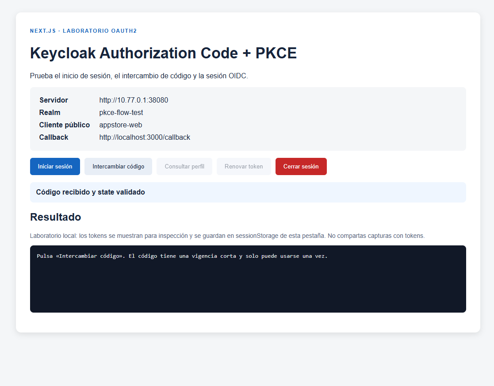
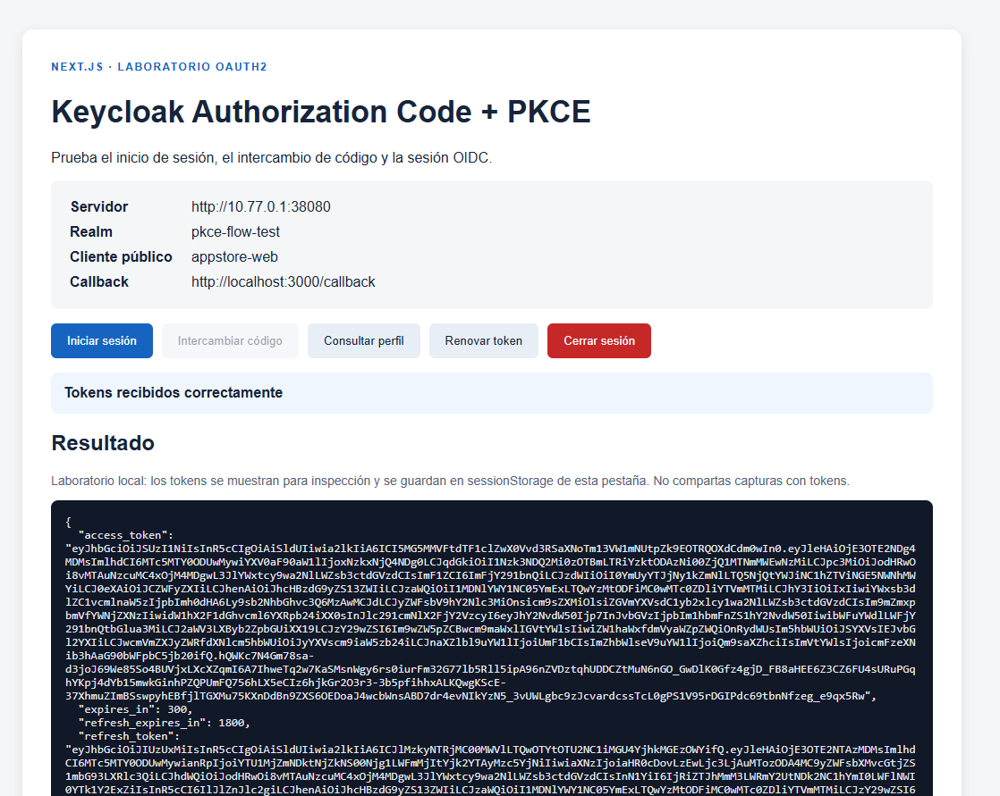
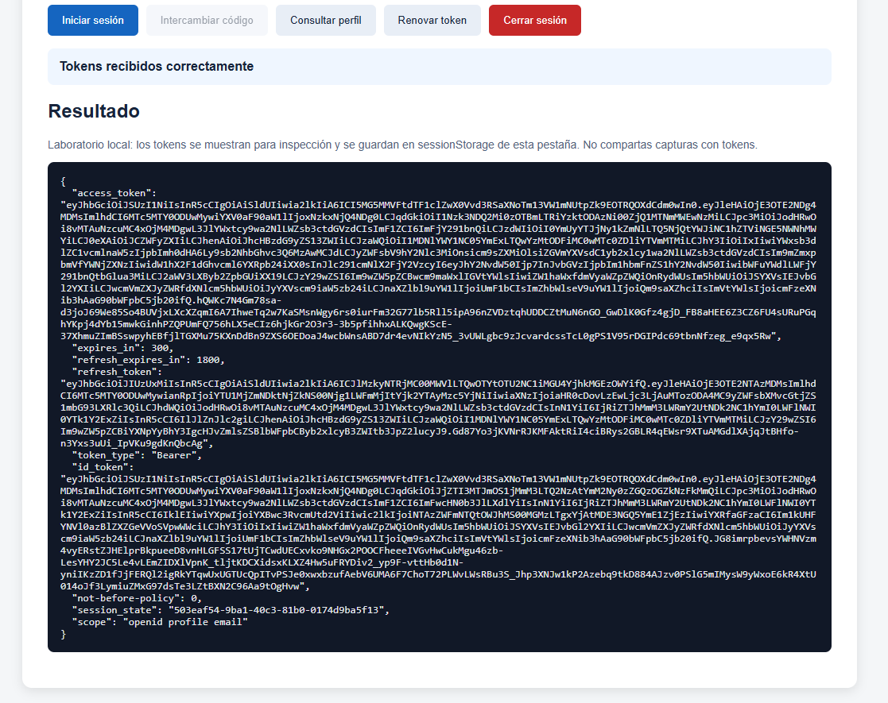
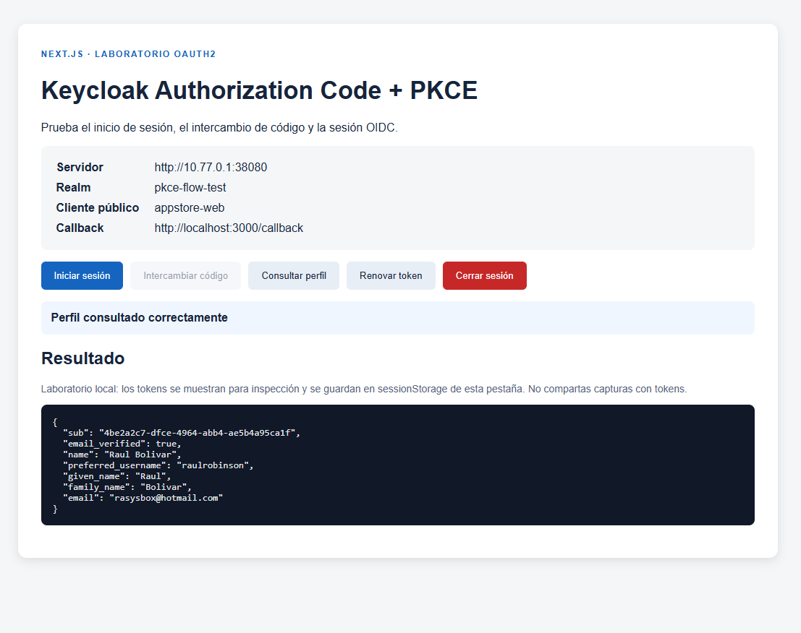

# RunBook

### Realm
- name: pkce-flow-test

### Clients
- name: appstore-web
    - Root URL: http://localhost:3000
    - Home URL: http://localhost:3000
    - Valid redirect URIs: http://localhost:3000/callback
    - Valid post logout redirect URIs: http://localhost:3000/
    - Web origins: http://localhost:3000
    - Admin URL: http://localhost:3000
    - Client authentication: Off
    - Authorization: Off
    - Authentication flow: Yes
    - Direct access grants: Yes
    - Implicit flow: Yes
    - (Advanced Settings) Proof Key for Code Exchange Code Challenge Method: S256
    - Client scopes: openid profile email

### Users
- username: raulrobinson
- email: rasysbox@hotmail.com
- first name: Raul
- last name: Bolivar
- credentials: 123456
- Email verified: Yes

### Iniciar Sesión


### Pagina de Login


### Intercambio de Código


### Consultar el Perfil del Usuario



### Cerrar Sesión


---

## JWT

### Decoded Header
```json
{
  "alg": "RS256",
  "typ": "JWT",
  "kid": "90nL1Qmu1urVp_EowtRishNmwUmf5KifOD94P9wBvm0"
}
```

### Decoded Payload
```json
{
  "exp": 1791649329,
  "iat": 1791649029,
  "auth_time": 1791649019,
  "jti": "03fafb6d-f82c-4d55-8512-9d48d45892a1",
  "iss": "http://10.77.0.1:38080/realms/pkce-flow-test",
  "aud": "account",
  "sub": "4be2a2c7-dfce-4964-abb4-ae5b4a95ca1f",
  "typ": "Bearer",
  "azp": "appstore-web",
  "sid": "3026505a-15ab-4fea-9840-294151a05bb8",
  "acr": "1",
  "allowed-origins": [
    "http://localhost:3000"
  ],
  "realm_access": {
    "roles": [
      "default-roles-pkce-flow-test",
      "offline_access",
      "uma_authorization"
    ]
  },
  "resource_access": {
    "account": {
      "roles": [
        "manage-account",
        "manage-account-links",
        "view-profile"
      ]
    }
  },
  "scope": "openid profile email",
  "email_verified": true,
  "name": "Raul Bolivar",
  "preferred_username": "raulrobinson",
  "given_name": "Raul",
  "family_name": "Bolivar",
  "email": "rasysbox@hotmail.com"
}
```

